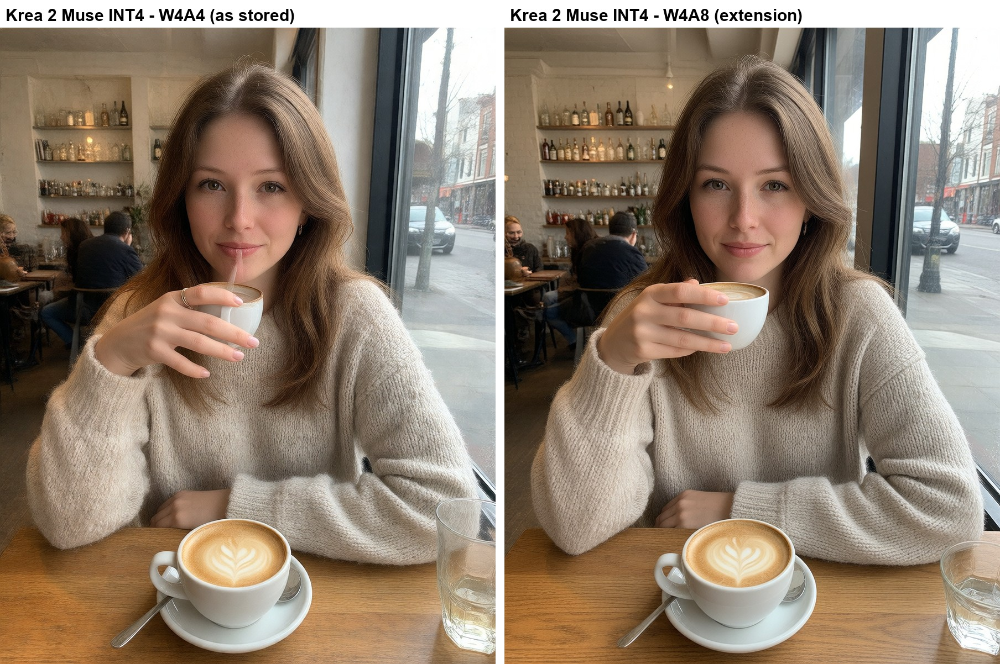
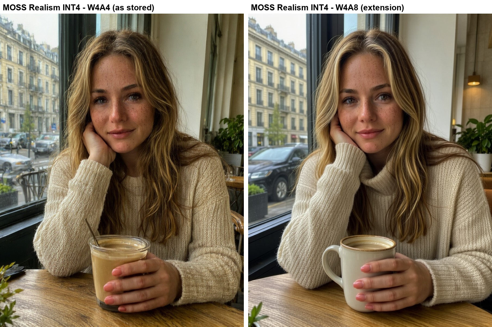

# 🪶 INT4 W4A8 for Forge Neo

> **Extension for [Stable Diffusion WebUI Forge - Neo](https://github.com/Haoming02/sd-webui-forge-classic/tree/neo)**

Cleaner pictures from the small INT4 checkpoints shared by the community (the ones made for 8 GB cards): same file, same memory, more precision.

---

## 🎯 What It Does

- Many INT4 checkpoints (the **INT4 ConvRot** ones, for Krea 2, MOSS-Image and other models) ask Forge Neo to squeeze both the model and its working numbers into 4 bits. That is what makes some of them look crunchy, over-sharpened or a little off
- With this extension, the model stays in 4 bits but its working numbers use 8 bits. Same file, no conversion, practically the same memory
- It is a little slower: on an RTX 2070, an 896x1152 MOSS-Image picture at 8 steps took 15 s instead of 13 s
- Pick how under **Settings → Stable Diffusion → [INT4 W4A8] Activations of INT4 ConvRot checkpoints**: **INT8 (W4A8)**, the default, or **As stored (W4A4)**, the way the file asks for. The change applies at the next generation, with no restart
- Other checkpoints (INT8, FP8, NVFP4, BF16...) are not affected
- An INT4 file still loses some detail next to an INT8 one: if your card has room, the INT8 file of the same model gives the best picture

---

## 📦 Installation

1. Go to **Extensions** → **Install from URL**
2. Paste: `https://github.com/eduardoabreu81/forge-neo-int4-w4a8`
3. Click **Install** and restart the WebUI

The console says `[INT4 W4A8] INT4 checkpoint activations: INT8 (W4A8)` when it switches a checkpoint.

> [!Note]
> Tested on an RTX 2070 (8 GB) with [Muse by Stable Yogi v4.0 INT4](https://civitai.com/models/2741166?modelVersionId=3416981) and [KREA 2 Turbo v10 INT4](https://civitai.com/models/2873257?modelVersionId=3368672) (Krea 2), and [Realism by Stable Yogi v1.0 INT4](https://civitai.com/models/3014108?modelVersionId=3421158) (MOSS-Image). Other models with INT4 ConvRot files have not been tested yet.

---

## 📄 Credits

- **[Forge Neo](https://github.com/Haoming02/sd-webui-forge-classic/tree/neo)** by Haoming02
- **[comfy-kitchen](https://github.com/Comfy-Org/comfy-kitchen)** by Comfy-Org - the INT4 ConvRot format and both of its paths

## 📜 License

AGPL-3.0 - see [LICENSE](LICENSE)
